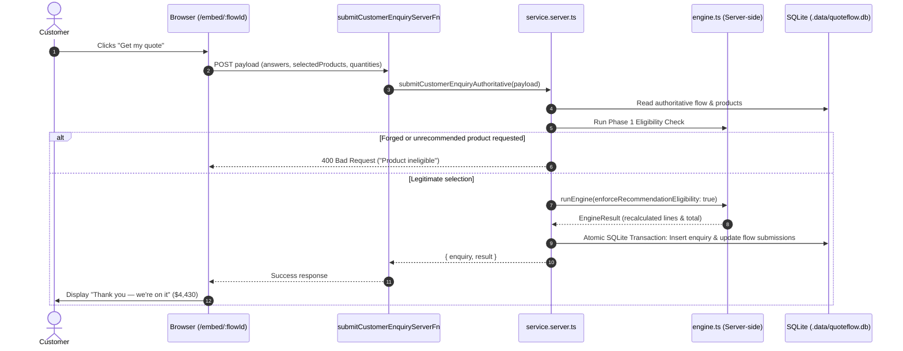
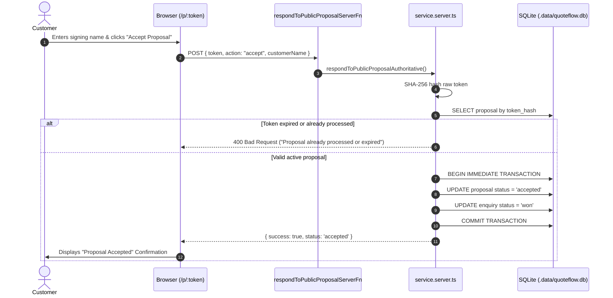

# QuoteFlow — Complete MVP Product & Business Logic Architecture Guide

> **Authoritative Technical & Domain Reference for Frontend Engineers, Business Stakeholders & Integrators**  
> *Grounded in Verified Repository Source Code (`feature/quoteflow-domain-foundation`, commit `6701973`)*

---

## Table of Contents
1. [Product Concept & Core Domain](#1-product-concept--core-domain)
2. [Dashboard Architecture & Metrics](#2-dashboard-architecture--metrics)
3. [Products Model & Catalog Lifecycle](#3-products-model--catalog-lifecycle)
4. [Packages & Add-ons Architecture](#4-packages--add-ons-architecture)
5. [Flow Builder & Form Engine Boundary](#5-flow-builder--form-engine-boundary)
6. [Business Rule Engine (Exhaustive Specification)](#6-business-rule-engine-exhaustive-specification)
7. [Authoritative Pricing Pipeline & Worked Examples](#7-authoritative-pricing-pipeline--worked-examples)
8. [End-to-End Customer Quotation Experience](#8-end-to-end-customer-quotation-experience)
9. [Enquiry Lifecycle & Snapshot Immutability](#9-enquiry-lifecycle--snapshot-immutability)
10. [Proposals & Customer Acceptance Lifecycle](#10-proposals--customer-acceptance-lifecycle)
11. [Backend Architecture, SQLite Schema & Security](#11-backend-architecture-sqlite-schema--security)
12. [Frontend-to-Backend Data Flow & State Reconciliation](#12-frontend-to-backend-data-flow--state-reconciliation)
13. [Remaining Architectural Risks & Pre-Production Audit](#13-remaining-architectural-risks--pre-production-audit)

---

## 1. Product Concept & Core Domain

### What QuoteFlow Solves
Service, rental, and event businesses (marquee hirers, caterers, photographers, wedding production companies, trade contractors) routinely lose deals due to slow, opaque quoting. Traditional quoting requires multi-day email tag, manual spreadsheet formulas, and unstandardized PDF proposals.

**QuoteFlow replaces static contact forms and manual spreadsheets with an interactive, guided quotation engine.** 

```mermaid
flowchart LR
    A["Customer Visits /embed/:flowId"] --> B["Answers Dynamic Requirements"]
    B --> C["Deterministic Pricing & Rules Fire Live"]
    C --> D["Customer Selects Add-ons & Quantities"]
    D --> E["Instant Frozen Quote & Enquiry Created"]
    E --> F["Owner Reviews & Adjusts in /enquiries"]
    F --> G["Owner Issues Proposal with Unguessable Token"]
    G --> H["Customer Accepts Online at /p/:token"]
    H --> I["Deal Won & Synchronized Across Devices"]
```



### Key Personas
1. **The Business Owner / Administrator:** Manages catalog items (products, packages), configures interactive flows and business rules, reviews incoming enquiries, makes manual adjustments, issues formal proposals, and tracks conversion metrics.
2. **The Customer:** Prospective event host, bride/groom, corporate planner, or homeowner who completes an interactive flow, sees live itemized estimates, chooses optional upgrades, submits an enquiry, and later reviews and signs off on formal proposals.

### Guided Quotation Explained
A **guided quotation** is an adaptive, dynamic questionnaire where answers in real time calculate charges, reveal or hide conditional questions, apply logistical rules, and present tailored product recommendations with instant pricing feedback.

### Key Domain Entities: Enquiry vs. Quote vs. Proposal
- **Enquiry (`Enquiry`):** A customer lead captured from an interactive flow submission. It stores the customer's contact details, raw answers, and a permanently frozen initial `quoteSnapshot`.
- **Quote (`QuoteSnapshot` / `EngineResult`):** An itemized mathematical valuation computed by `runEngine`. Contains base package charges, calculations, rule additions, customer-selected recommendations, fees, discounts, and total.
- **Proposal (`Proposal`):** The formal, legally-binding commercial document issued by the owner to the customer. Contains the issued `proposalSnapshot`, an unguessable public share token, expiration date, acceptance terms, and state (`draft`, `sent`, `accepted`, `changes_requested`, `declined`).

### Realistic Business Use Cases Supported Today
- **Event & Marquee Rental (`fl_event_rental`):** Signature package ($2,500 for up to 250 guests), distance-based travel fees (>$30 km = $150), outdoor lighting recommendations, sound system recommendations for >200 guests, staging for weddings with >150 guests, and optional dance floor ($480) or patio heater add-ons.
- **Wedding Photography (`fl_wedding`):** Coverage package ($2,500), layflat albums ($300), drone footage ($200), staffing rules for large guest counts.
- **Catering (`fl_catering`):** Core package ($1,800), cuisine selection, guest headcount calculations, canapé add-ons ($420).

---

## 2. Dashboard Architecture & Metrics

Located at `src/routes/index.tsx`. The Dashboard provides high-level conversion and pipeline visibility.

```
+-------------------------------------------------------------------------------+
| Turn enquiries into quotes in minutes.                         [Refresh Sync] |
| Collect requirements, apply business rules, configure solutions.              |
+-------------------------------------------------------------------------------+
| ACTIVE ENQUIRIES  |  QUALIFIED PIPELINE  |  QUOTES ISSUED  |  CONVERSION RATE |
|       4           |       $14,230        |       3         |       25%        |
|  +12% vs last mo  |  Active lead value   |  Working quotes |  Proposals sent  |
+-------------------------------------------------------------------------------+
```

### Metrics Breakdown

| Metric Card | Value Shown | Source of Data | Calculation / Logic | Misleading Caveats / Limitations in MVP |
| :--- | :--- | :--- | :--- | :--- |
| **Total Enquiries** | Count of all leads | `ws.enquiries.length` | Simple count of all enquiries in SQLite store. | Includes archived and lost test enquiries. |
| **Qualified Pipeline** | Dollar amount | `sum(valueOf(enquiry))` | Sum of `getEnquiryTotal(enquiry, ws)` across all enquiries. | Recalculates dynamically using current catalog if working quote is active. |
| **Quotes Issued** | Count of processed leads | `enquiries.filter(e => e.status !== "new").length` | Counts enquiries that moved past `new` into `qualified`, `quoted`, or `won`. | Does not distinguish between a draft working quote and a formal sent proposal. |
| **Conversion Rate** | Percentage | `Math.round((sent / ws.enquiries.length) * 100)` | Ratio of proposals with `status !== "draft"` divided by total enquiries. | If a proposal is sent multiple times or reset, this ratio does not account for revisions. |

---

## 3. Products Model & Catalog Lifecycle

Defined in `src/lib/quoteflow/types.ts` (`interface Product`). Seeded in `src/lib/quoteflow/seed.ts`.

### Schema & Fields
```typescript
interface Product {
  id: string;          // Immutable identifier, e.g. "p_std_chair", "p_lighting"
  name: string;        // Human-readable title, e.g. "Lighting Package"
  sku: string;         // Internal inventory code, e.g. "LGT-PKG"
  description: string; // Detail shown on line items and recommendation cards
  price: number;       // Base unit price in dollars (e.g. 650 = $650.00)
  unit: string;        // Unit descriptor: "flat", "per chair", "per table", "day"
  category: string;    // Organization tag: "Furniture", "Production", "Logistics"
  active: boolean;     // Soft-activation toggle
}
```

### Units and Quantity Multiplication
- In `runEngine` (lines 748–824 of `engine.ts`):
  - Every line item receives an integer `quantity` (sanitized between `1` and `9999`).
  - Unit price is strictly clamped: `unitPrice = Math.round(Math.max(0, p.price) * 100) / 100`.
  - Line amount is strictly multiplied: `lineAmount = Math.round(unitPrice * quantity * 100) / 100`.
  - Line item detail displays quantity multiplication: `2 × $650.00 (flat)`.

### Active vs. Inactive Products
- When `p.active === false` (e.g., `p_drone` in seed):
  - The product is ignored by `runEngine` recommendation and `add_to_quote` rules.
  - If a customer attempts to select an inactive product, server validation in `submitCustomerEnquiryAuthoritative` rejects the submission with `400 Bad Request`.

### Product Price Updates & Historical Immutability
- Changing a product price in `/products` calls `upsertProductServerFn` which writes to SQLite.
- **Future Quotes:** Any new customer quote or newly evaluated working quote immediately uses the updated price.
- **Past Quotes:** Existing submitted enquiries retain their frozen `enquiry.quoteSnapshot`. Past quotes and issued proposals **never** change when catalog prices change.

---

## 4. Packages & Add-ons Architecture

Defined in `src/lib/quoteflow/types.ts` (`interface Package`).

```typescript
interface Package {
  id: string;               // e.g. "pk_event_rental"
  name: string;             // "Signature Event Rental Package"
  description: string;      // Core rental setup description
  price: number;            // Fixed package price ($2,500)
  includes: string[];       // Display list of bundled items
  addons: PackageAddon[];   // Optional selectable upgrades: { id, name, price }
  archived: boolean;        // Soft-delete toggle
}
```

### Double-Charging Prevention
1. **Bundled Items (`package.includes`):** The Signature package includes `"250 premium chairs"`. If an admin or flow recommends additional chairs via a calculation, the base 250 chairs bundled in the package are not charged separately—only additional quantities or distinct product lines are added.
2. **Add-on vs. Catalog Isolation:** Package add-ons (`a_dance`, `a_heaters`, `a_bar`) are distinct from standalone catalog products. They have unique IDs and are billed as `source: "addon"`.
3. **Idempotent Line Deduction:** `engine.ts` deduplicates line items by `id` and `targetId`. If a package is charged, a duplicate package line is never emitted.

---

## 5. Flow Builder & Form Engine Boundary

### Architecture Boundary
The visual form builder utilizes `@devcode-tech/form-builder` and `@devcode-tech/gamiflow-core` behind SSR-safe wrappers (`ClientOnlyFormBuilder.tsx`, `ClientOnlyFormPreview.tsx`).
The translation between QuoteFlow's native domain schema (`Flow`, `FlowComponent`, `Rule`) and the external form-builder AST is managed by `src/lib/quoteflow/form-builder-adapter.ts`.

```
[QuoteFlow Flow Schema] <---- bidirectional adapter ----> [@devcode-tech/form-builder AST]
(components, rules, vars)   toFormBuilderSchema() / merge...    (nodes, steps, fields)
```

### Component Types Supported in Flows
- `text`: Single-line text input (e.g. `location`, `couple_names`).
- `number`: Numeric input with `min`, `max`, and `unit` (e.g. `guest_count`, `delivery_distance`, `chairs_required`).
- `dropdown`: Single-select dropdown menu with options `{ id, label, value }`.
- `multiselect`: Multi-item checklist returning an array of string values.
- `date`: Date picker component (`event_date`).
- `variable`: Non-visual backend variable with a `defaultValue`.
- `calculation`: Mathematical formula computing derived values from other variables.
- `price-summary`: Interactive preview widget rendering live totals, recommendation cards, and add-on selectors.

### Contact Questions vs. Requirement Questions
Flows support two component arrays:
1. `contactFields`: System fields (`contact_name`, `contact_email`, `contact_phone`, `contact_company`) collecting customer identity.
2. `components`: Requirement fields collecting event parameters and driving rules.

### What Happens When a Question is Renamed or Deleted
- Variables are stable identifiers (`c.variable`). Renaming a label (e.g. "Number of Attendees" -> "Guest Count") preserves the underlying variable `guest_count`.
- If a component is deleted, rules referencing its variable evaluate to `false`/empty, calculations treat the missing variable as `0` and emit a warning in `result.errors`, but the engine does not crash.

---

## 6. Business Rule Engine (Exhaustive Specification)

QuoteFlow features an iterative business evaluation engine implemented in `src/lib/quoteflow/engine.ts`.

### Condition Matching
- `match: "all"`: Logical AND. Every condition in `rule.conditions` must evaluate to `true`.
- `match: "any"`: Logical OR. At least one condition must evaluate to `true`.

### Supported Operators
- `equals`: Exact string equality (`case-insensitive` for text, strict for numbers).
- `not_equals`: Inverted equality.
- `gt`: Numeric strictly greater than (`>`): `num(answer) > num(target)`.
- `gte`: Numeric greater than or equal to (`>=`): `num(answer) >= num(target)`.
- `lt`: Numeric strictly less than (`<`): `num(answer) < num(target)`.
- `lte`: Numeric less than or equal to (`<=`): `num(answer) <= num(target)`.
- `contains`: Substring or array inclusion (e.g. multiselect `extras` contains `"lighting"`).
- `not_contains`: Inverted inclusion.

### Exhaustive Rule Actions Specification

| Action Type | Purpose | Example Seed Configuration | Pricing Effect | Conflict / Precedence |
| :--- | :--- | :--- | :--- | :--- |
| `recommend` | Surfaces an optional active product or package card for customer selection. | `r1`: `guest_count > 200` -> `recommend p_sound` | Does NOT charge the customer automatically. Adds item to `result.recommendedProducts`. Only charges if customer clicks "Add". | If `add_to_quote` also targets the same product, `add_to_quote` takes precedence (charged automatically, removed from unselected recommendations). |
| `add_to_quote` | Automatically includes and charges a product on the quote. | `guest_count > 300` -> `add_to_quote p_staffing` | Billed directly on quote as `source: "rule_action"`. Multiplies by quantity if specified. | Overridden by `remove_from_quote`. |
| `remove_from_quote` | Strips a product from the quote even if selected or previously added. | `event_type == "exhibition"` -> `remove_from_quote p_lighting` | Completely removes product from lines, customer selections, and recommendations. | Highest precedence among product actions. |
| `add_fee` | Adds a mandatory surcharge or logistical fee line item. | `r4`: `delivery_distance > 30` -> `add_fee "Travel Fee" $150` | Appends a fee line item (`source: "fee"`). Contributes to subtotal. | Multiple rules can add distinct fees. |
| `apply_discount` | Deducts a fixed dollar discount from the subtotal. | `guest_count > 500` -> `apply_discount $250` | Reduces total: `total = max(0, subtotal - discount)`. Safe clamp prevents negative total. | Cumulative if multiple rules match. |
| `show` | Dynamically reveals a hidden component in the form. | `event_type == "other"` -> `show c_other_details` | Allows customer to answer conditional question. | Overrides component-level `showWhen` conditions. Inverts `hide`. |
| `hide` | Dynamically hides a component in the form. | `outdoor == "indoor"` -> `hide c_weather_plan` | Hides question and **prunes** its answers from downstream pricing evaluation. | Inverts `show`. |
| `set_value` | Sets the value of a form variable programmatically. | `guest_count > 200` -> `set_value delivery_distance = 45` | Updates variable in memory and triggers convergence re-pass. | Protected by 10-pass cycle detection limit. |
| `set_score` | Computes lead qualification score. | `event_type == "wedding"` -> `set_score +20` | Increments `result.score`. No direct pricing effect. | Cumulative. |

### Convergence, Derived Variables & Topological Calculations
1. **Topological Calculation Sorting:** Calculations are sorted in dependency order so that if `calc2` depends on `calc1`, `calc1` evaluates first.
2. **Convergence Loop (Phase 1):** The engine executes up to 10 passes. If a rule fires `set_value`, newly modified variables trigger recalculation of dependent formulas and re-evaluation of conditional visibility until states stabilize (`converged: true`). If a circular loop is detected, it terminates cleanly and reports an error.
3. **Effective Answers & Pruning:** When an answer changes and causes a previously visible question to hide, `getEffectiveAnswers()` strips the hidden variable so draft values cannot trigger residual charges or rules.

---

## 7. Authoritative Pricing Pipeline & Worked Examples

Pricing evaluation strictly follows an 8-phase pipeline:

```
[Phase 1: Base Package] ($2,500)
       +
[Phase 2: Package Add-ons] (Dance floor: $480)
       +
[Phase 3: Calculated Charges] (Seating total: 250 chairs × $9 = $2,250 if includeInQuote)
       +
[Phase 4: Rule-Added Products] (p_staffing: 1 × $250)
       +
[Phase 5: Customer Recommendations] (p_lighting: 2 × $650 = $1,300)
       +
[Phase 6: Fees] (Travel Fee: $150)
       +
[Phase 7: Manual Adjustments] (Owner manual adjustment if configured)
       =
   SUBTOTAL: $6,930.00
       -
   DISCOUNTS: $0.00 (Clamped to <= subtotal)
       =
   FINAL TOTAL: $6,930.00
```

### Worked Numerical Example (Event Rental Seed)
- **Scenario:** Sarah Johnson's Wedding Enquiry
  - `event_type = "wedding"`
  - `guest_count = 250`
  - `outdoor = "outdoor"`
  - `delivery_distance = 42`
  - Customer selects `a_dance` ($480)
  - Customer selects recommended `p_lighting` with quantity `2` ($650 each = $1,300)
- **Evaluation:**
  1. Base package `pk_event_rental`: **$2,500.00**
  2. Selected add-on `a_dance`: **$480.00**
  3. Rule `r4` (`delivery_distance > 30`): adds `"Travel Fee"`: **$150.00**
  4. Rule `r2` (`outdoor == "outdoor"`): recommends `p_lighting`. Customer selected 2 units: **$1,300.00**
  5. Rule `r1` (`guest_count > 200`): recommends `p_sound`. Customer did not select: **$0.00**
  6. Rule `r5` (`wedding` and `guest_count >= 150`): recommends `p_stage`. Customer did not select: **$0.00**
- **Subtotal:** $2,500 + $480 + $150 + $1,300 = **$4,430.00**
- **Discounts:** **$0.00**
- **Final Quote Total:** **$4,430.00**

---

## 8. End-to-End Customer Quotation Experience

1. **Accessing Hosted Form (`/embed/:flowId`):**
   - The customer navigates to or embeds `/embed/fl_event_rental`.
   - The route loader calls `getPublicFlowServerFn`, returning public flow metadata and sanitizing private webhooks and credentials.
2. **Step 1 (Contact Details):**
   - Customer enters Name, Email, Phone, Company.
   - Client-side validation checks required fields and email formatting.
3. **Step 2 (Requirements & Live Estimation):**
   - As fields are updated, the price sidebar instantly runs client-side `runEngine` for real-time visual feedback.
   - Active recommendations appear with interactive "+ Add" buttons.
   - Selected recommendations expose `[ - ] [ qty ] [ + ]` stepper controls.
   - Total updates live as add-ons and quantities change.
4. **Submission (`submitCustomerEnquiryServerFn`):**
   - Client submits answers, selected recommendations, and add-ons.
   - Server re-executes `runEngine` with `enforceRecommendationEligibility: true`.
   - Server validates eligibility, quantities (1..9999), recalculates line items, and persists enquiry and quote snapshots to SQLite.
5. **Success Confirmation:**
   - Displays confirmation screen: *"Thank you — we're on it."* with the exact confirmed total and enquiry reference ID.

---

## 9. Enquiry Lifecycle & Snapshot Immutability

Defined in `src/lib/quoteflow/types.ts` (`interface Enquiry`).

```typescript
interface Enquiry {
  id: string;                      // e.g. "en_sarah"
  customer: string;                // "Sarah Johnson"
  email: string;                   // "sarah.johnson@example.com"
  business: string;                // "Wedding"
  flowId: string;                  // "fl_event_rental"
  status: EnquiryStatus;           // "new" | "qualified" | "quoted" | "won" | "lost"
  createdAt: string;               // ISO 8601 date
  answers: Answers;                // Customer submitted answers
  selectedAddons: string[];        // Chosen package add-on IDs
  selectedProducts?: string[];     // Customer chosen product IDs
  productQuantities?: Record<string, number>;
  quoteSnapshot: QuoteSnapshot;    // FROZEN AT SUBMISSION
  workingQuoteConfig?: EnquiryQuoteConfig; // Business owner custom revisions
  workingQuoteSnapshot?: QuoteSnapshot;    // Current working quote
}
```

### Snapshot Immutability Principle
The `quoteSnapshot` created at submission time is **immutable**. It records exactly what the customer was quoted at that second. Even if the owner later edits product prices in `/products`, Sarah Johnson's historical quote remains $4,430.00 forever.

---

## 10. Proposals & Customer Acceptance Lifecycle

Located at `src/routes/proposals.$enquiryId.tsx` and public customer route `src/routes/p.$token.tsx`.

### Working Quote vs. Issued Proposal
1. **Working Quote (`workingQuoteConfig`):** The business owner can adjust quantities, add unrecommended catalog products, apply custom discounts, or attach notes in `/enquiries/:enquiryId`.
2. **Approving and Issuing (`approveAndIssueProposalServerFn`):**
   - Freezes `workingQuoteSnapshot` into an immutable `ProposalSnapshot`.
   - Generates a cryptographically unguessable, 256-bit URL-safe share token (using `crypto.randomBytes(32)`).
   - Hashes token using SHA-256 for storage in `proposal_tokens` table.
   - Sets status to `"sent"` and creates expiration date (default 14 days).

### Customer Actions on Public Proposal (`/p/:token`)
- **Review:** Customer sees formal itemized document with validity expiration, terms, deposit requirements, and line items.
- **Accept:** Customer enters signing name and clicks "Accept Proposal". Server atomically updates proposal status to `"accepted"`, marks enquiry status to `"won"`, and records signature timestamp.
- **Request Modifications:** Customer submits revision feedback; status updates to `"changes_requested"`.
- **Decline:** Customer marks proposal as declined; status updates to `"declined"`.

---

## 11. Backend Architecture, SQLite Schema & Security

QuoteFlow runs on **TanStack Start with a Node.js 22+ native runtime**, using `node:sqlite` in Write-Ahead Logging (WAL) mode.

### Database Tables (`.data/quoteflow.db`)

```sql
-- Workspaces table storing domain state
CREATE TABLE IF NOT EXISTS workspaces (
  id TEXT PRIMARY KEY,
  revision INTEGER NOT NULL DEFAULT 1,
  data TEXT NOT NULL,
  created_at TEXT NOT NULL,
  updated_at TEXT NOT NULL
);

-- Unguessable hashed tokens for public proposals
CREATE TABLE IF NOT EXISTS proposal_tokens (
  token_hash TEXT PRIMARY KEY,
  proposal_id TEXT NOT NULL,
  enquiry_id TEXT NOT NULL,
  workspace_id TEXT NOT NULL,
  created_at TEXT NOT NULL,
  expires_at TEXT NOT NULL,
  revoked INTEGER NOT NULL DEFAULT 0
);

-- Idempotency keys preventing duplicate public submissions
CREATE TABLE IF NOT EXISTS idempotency_keys (
  key TEXT PRIMARY KEY,
  response TEXT NOT NULL,
  created_at TEXT NOT NULL
);

-- Persistent brute-force rate limiter
CREATE TABLE IF NOT EXISTS auth_rate_limits (
  scope_key TEXT PRIMARY KEY,
  failed_count INTEGER NOT NULL DEFAULT 0,
  first_failed_at INTEGER NOT NULL,
  locked_until INTEGER
);

-- Point-in-time recovery backups before destructive operations
CREATE TABLE IF NOT EXISTS workspace_backups (
  id TEXT PRIMARY KEY,
  workspace_id TEXT NOT NULL,
  revision INTEGER NOT NULL,
  data TEXT NOT NULL,
  reason TEXT NOT NULL,
  created_at TEXT NOT NULL
);
```

### Sequence Diagrams

#### A. Public Customer Submission


#### B. Public Proposal Acceptance


---

## 12. Frontend-to-Backend Data Flow & State Reconciliation

### Client-to-Server Mutation Flow
Every administrative action follows a strict, predictable path:
1. **Component Trigger:** An admin edits a product price in `src/routes/products.tsx`.
2. **Store Action (`useActions().upsertProduct`):**
   - Optimistically updates client-side in-memory `state`.
   - Debounces network write (250ms).
   - Sets `setSyncStatus("syncing", null)`.
3. **Server RPC (`upsertProductServerFn`):**
   - Validates admin session cookie via `requireAdminSession()`.
   - Passes payload and `expectedRevision` to `upsertProductAuthoritative()`.
4. **Service & SQLite Concurrency:**
   - Atomic transaction verifies `revision === expectedRevision`.
   - Updates record and increments `revision += 1`.
5. **State Reconciliation:**
   - Client receives `{ product, workspaceRevision }`.
   - Confirms snapshot, sets `serverRevision = res.workspaceRevision`, sets `setSyncStatus("idle", null)`.
   - On error/conflict, automatically rolls back to `lastConfirmedServerSnapshot` and displays error banner.

---

## 13. Remaining Architectural Risks & Pre-Production Audit

Before taking QuoteFlow to public multi-tenant production, the following architectural items should be addressed:

1. **Multi-Tenancy Workspace Partitioning:** Currently, the system uses a single workspace key (`ws_default`). True multi-tenant production will require scoping all database queries by an authenticated `organization_id` or `workspace_id`.
2. **Webhook & Notification Dispatch:** When an enquiry or accepted proposal is submitted, QuoteFlow records notifications in memory and logs them to the console, but does not yet dispatch asynchronous outbound HTTP webhooks to external CRMs (HubSpot, Salesforce, Zapier).
3. **PDF Generation Service:** Currently, proposal documents render high-resolution printable HTML/CSS (`window.print()`). An automated server-side headless Chromium PDF rendering microservice would allow automated email attachments.
4. **Direct Stripe / Payment Gateway Integration:** The deposit percentage calculation is fully modeled in `WorkspaceSettings`, but collecting credit card payments directly on `/p/:token` requires integrating Stripe Elements or checkout sessions.
